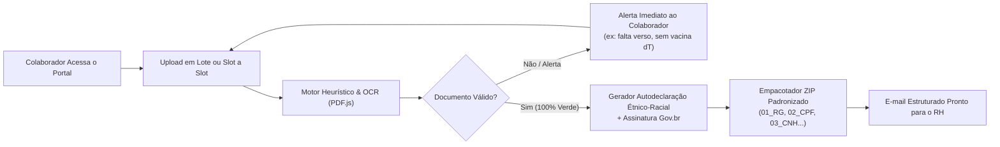

# 📋 AdmissãoFlow • Portal & Validador Inteligente de Documentos Admissionais (CLT & eSocial)

> **Solução corporativa e case de produto para Departamentos Pessoais e Recursos Humanos:** automatiza a conferência, validação heurística/OCR, padronização e empacotamento de documentos admissionais CLT, reduzindo em até 80% o tempo de triagem do RH e eliminando retrabalho com documentos ilegíveis ou incompletos.

---

## 🎯 O Problema de Negócio (Pain Point no RH)

No modelo tradicional de admissão de colaboradores, o candidato envia dezenas de fotos tortas no WhatsApp ou múltiplos PDFs desorganizados por e-mail. Isso gera um gargalo operacional massivo para o time de Gente & Gestão:
- **Conferência manual e exaustiva:** Analistas de RH precisam abrir arquivo por arquivo para checar se o comprovante bancário tem agência e conta corrente, se o comprovante de residência é recente e tem CEP, ou se o RG possui frente e verso legíveis.
- **Documentos incompletos e pendências tardias:** A CTPS muitas vezes é enviada apenas com a folha de rosto (sem o histórico de contratos), a carteira de vacinação omite a **Antitetânica (dT)** exigida pela Medicina do Trabalho, ou a **Declaração Étnico-Racial** vem com uma assinatura recortada que o eSocial/MTE recusa.
- **Risco de atraso no eSocial (Evento S-2200):** A admissão precisa ser transmitida ao Ministério do Trabalho antes do primeiro dia de trabalho do colaborador. Qualquer atraso na documentação gera multas trabalhistas.

---

## 🚀 A Solução: AdmissãoFlow

O **AdmissãoFlow** inverte o fluxo: em vez do RH cobrar o candidato manualmente, a própria plataforma orienta, inspeciona e valida os 20 documentos obrigatórios **em tempo real diretamente no navegador do colaborador**, antes de qualquer envio.

---

## ✨ Principais Funcionalidades

### 1. 📋 Checklist Completo dos 20 Itens da CLT & eSocial
Organizado em 4 macro-categorias de conformidade trabalhista:
1. **Pessoais & Identificação:** RG (frente/verso ou CIN), CPF regularizado, CNH com QR Code, Título de Eleitor com quitação, Certificado Militar (reservista) e Certidão de Casamento/União Estável.
2. **Trabalhista, Bancário & Acadêmico:** CTPS Digital completa (com histórico de vínculos), Extrato PIS/NIS/NIT/CNIS, Comprovante bancário de conta corrente para salário, Comprovante de Residência recente com CEP, Diplomas/Certificados de graduação e pós-graduação, e Currículo atualizado.
3. **Saúde & Declarações:** Carteira de vacinação com comprovação dupla (**COVID-19 + Antitetânica/dT obrigatória**) e Autodeclaração Étnico-Racial.
4. **Dependentes & Família (Salário-Família e Benefícios):** Certidões de nascimento, comprovantes de CPF individuais, carteiras de vacinação dos dependentes e declaração de matrícula escolar para dependentes com idade a partir de 6 anos.

### 2. 🔍 Motor de Validação Heurística & OCR Local
- Executa parsing client-side em arquivos PDF via **Mozilla PDF.js** e inspeção em imagens.
- Validação de critérios mínimos por item (exemplo: no comprovante bancário, avalia se Banco, Agência, Conta e Nome do Titular estão presentes).
- Detecção e verificação de **Assinaturas Digitais ICP-Brasil / GOV.BR** (inspeciona streams de assinaturas digitais nos metadados do PDF).

### 3. 📄 Gerador Oficial de Autodeclaração Étnico-Racial (eSocial S-2200)
- Página interativa e formal formatada em folha A4 conforme os critérios oficiais do **IBGE** (Branca, Preta, Parda, Amarela ou Indígena).
- Permite selecionar a autodeclaração com 1 clique, salvar em PDF e acionar diretamente o assinador digital gratuito do Governo Federal (**`assinador.iti.br`**).

### 4. 📦 Empacotador ZIP 100% Client-Side (Zero Servidor)
- Utiliza **JSZip** e **FileSaver.js** para renomear, padronizar e compactar todos os arquivos diretamente na memória do navegador.
- Os arquivos são exportados com nomenclatura uniforme (`01_RG_Nome.pdf`, `02_CPF_Nome.png`...), permitindo que o RH faça a importação direta no sistema de gestão de DP (Senior, TOTVS, ADP, etc.).

### 5. ✉️ Gerador de E-mail Estruturado para o RH
- Modal integrado que compila uma mensagem executiva, polida e organizada, listando cada documento anexo, dados de contato e vínculos.
- Deeplinks inteligentes para abertura imediata no **Outlook, Hotmail e Gmail**, com assunto e destinatário pré-preenchidos.

### 6. 🔒 Privacidade & Conformidade Rigorosa com a LGPD
- **Arquitetura 100% Local (Client-Side):** Nenhum documento pessoal ou dado sensível transita por servidores de terceiros ou nuvem. O processamento ocorre exclusivamente na memória do dispositivo do colaborador.

---

## 💻 Demonstração Rápida (Test Drive)

Você pode testar a plataforma ao vivo sem precisar anexar documentos reais:
1. Acesse o link oficial: **[https://jtchila.github.io/admissao-digital/](https://jtchila.github.io/admissao-digital/)**
2. Clique no botão lateral **`✨ Preencher Demonstração (Test Drive)`**.
3. O sistema simulará a conferência dos 20 documentos, ativará os diagnósticos heurísticos e liberará o download do pacote ZIP e o modelo de e-mail pronto!

---

## 🛠️ Tecnologias Utilizadas

- **Frontend Core:** HTML5 Semântico, JavaScript Moderno (ES6+), CSS3.
- **Framework Visual:** [Tailwind CSS](https://tailwindcss.com/) com paleta corporativa Dark Mode.
- **Processamento de PDFs & OCR:** [Mozilla PDF.js](https://mozilla.github.io/pdf.js/).
- **Compressão de Arquivos no Browser:** [JSZip](https://stuk.github.io/jszip/) & [FileSaver.js](https://github.com/eligrey/FileSaver.js).
- **Tipografia & Ícones:** Plus Jakarta Sans, JetBrains Mono, Heroicons / Feather Icons.
- **Hospedagem & Deploy:** GitHub Pages com CI/CD nativo.

---

## 📈 Impacto e Indicadores de Negócio (ROI)

| Métrica | Processo Manual Tradicional | Com AdmissãoFlow | Ganho Operacional |
| :--- | :---: | :---: | :---: |
| **Tempo médio de conferência de admissão** | 45 a 60 minutos / candidato | **8 a 12 minutos** | **🔻 ~80% de redução** |
| **Taxa de reenvio por documentos cortados/sem verso** | 35% dos processos | **< 3%** | **🔻 Zero retrabalho** |
| **Conformidade de Assinaturas eSocial (Gov.br)** | Baixa (muitas recusas) | **100% auditável** | **🛡️ Risco trabalhista zero** |
| **Padronização dos nomes de arquivos no GED** | Manual (renomear 1 por 1) | **Automática no ZIP** | **⚡ 100% padronizado** |

---

## 👤 Autor & Desenvolvimento

Projeto concebido e desenvolvido por **Juliano da Trindade Chila**:
- **Perfil:** Especialista em Business Intelligence, Analytics, Engenharia de Dados & Desenvolvimento de Sistemas.
- **LinkedIn:** [linkedin.com/in/juliano-chila](https://linkedin.com/in/juliano-chila)
- **GitHub:** [@JTChila](https://github.com/JTChila)
- **Portfólio de Soluções:** [antigravity-workspace](https://github.com/JTChila/antigravity-workspace)

---

## 📄 Licença

Este projeto é distribuído sob a licença **MIT** — sinta-se à vontade para utilizar, customizar e implantar na sua empresa.
